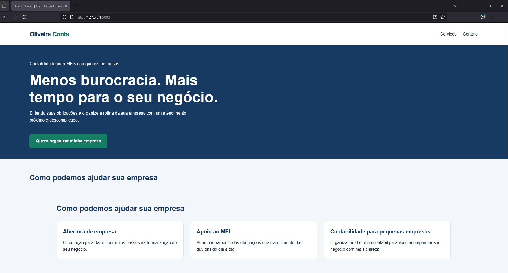
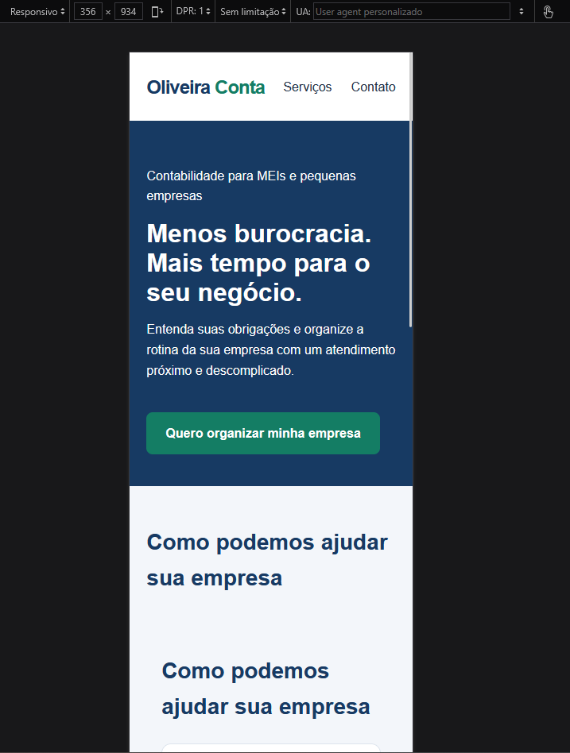

# Oliveira Conta

Landing page de um escritório fictício de contabilidade, voltado
a MEIs e pequenas empresas.

Projeto desenvolvido por Alann Oliveira para praticar desenvolvimento
web e compor seu portfólio. Não oferece serviços contábeis reais.

## Demonstração visual

### Versão para computador



### Versão para celular



## Funcionalidades

- Apresentação dos serviços.
- Layout responsivo.
- Formulário de contato integrado ao Flask.
- Validação dos campos no servidor.
- Validação do formato do e-mail com email-validator.
- Preservação dos campos após erros de validação.
- Armazenamento de contatos no SQLite.
- Mensagens visuais de erro e sucesso.
- Tratamento de falhas de gravação no banco.
- Redirecionamento após cadastro para evitar reenvio ao atualizar.
- Proteção CSRF no formulário.
- Assinatura visual AO Dev no rodapé.

## Tecnologias

- HTML
- CSS
- JavaScript — utilizado na demonstração inicial do formulário
- Python
- Flask e Jinja
- SQLite
- email-validator
- Flask-WTF
- python-dotenv
- Git e GitHub

## Como executar no Windows

É necessário ter Python e Git instalados.

### 1. Clonar o repositório

```powershell
git clone https://github.com/AlannCristian/oliveira-conta.git
cd oliveira-conta
```

### 2. Criar o ambiente virtual

```powershell
py -m venv .venv
```

### 3. Instalar as dependências

```powershell
.\.venv\Scripts\python.exe -m pip install -r requirements.txt
```

### 4. Configurar a chave secreta

Gere uma chave aleatória:

```powershell
.\.venv\Scripts\python.exe -c "import secrets; print(secrets.token_hex(32))"
```

Na pasta principal do projeto, ao lado de `app.py`, crie um arquivo
chamado `.env` com este conteúdo:

```dotenv
SECRET_KEY=cole_aqui_a_chave_gerada
```

Substitua o texto após `=` pelo resultado do comando.

A aplicação usa essa chave para assinar a sessão e os tokens de
proteção CSRF. Cada ambiente deve usar sua própria chave.

O arquivo `.env` deve permanecer no `.gitignore` e não deve ser
enviado ao GitHub. Não coloque a chave verdadeira no README.

### 5. Preparar o banco

```powershell
.\.venv\Scripts\python.exe banco.py
```

Esse comando cria o arquivo `contatos.db` e a tabela de contatos,
caso ainda não existam.

### 6. Iniciar o servidor de desenvolvimento

```powershell
.\.venv\Scripts\python.exe -m flask --app app run
```

Acesse http://127.0.0.1:5000/ no navegador.

Para encerrar o servidor, pressione Ctrl + C no terminal.

O servidor de desenvolvimento é destinado à execução local.
A publicação exige uma configuração de hospedagem apropriada.

## Organização do projeto

| Caminho                | Responsabilidade                                         |
| ---------------------- | -------------------------------------------------------- |
| `app.py`               | Rotas, validação, proteção CSRF e respostas da aplicação |
| `banco.py`             | Criação da tabela e gravação dos contatos                |
| `templates/index.html` | Estrutura da página e templates Jinja                    |
| `static/style.css`     | Estilos e adaptação para diferentes telas                |
| `static/script.js`     | Arquivo da demonstração inicial; envio atual via HTML    |
| `static/img/`          | Imagens e assinatura visual do desenvolvedor             |
| `docs/imagens/`        | Capturas de tela utilizadas neste README                 |
| `requirements.txt`     | Dependências Python e suas versões                       |
| `.gitignore`           | Regras para arquivos que não devem ser versionados       |
| `.env`                 | Configuração local da chave secreta; não versionada      |
| `contatos.db`          | Banco local de contatos; não versionado                  |

## Funcionamento do formulário

1. O visitante preenche nome, e-mail e serviço.
2. O navegador envia uma requisição POST com os campos e o token CSRF.
3. O Flask-WTF verifica o token.
4. A aplicação valida os dados recebidos.
5. Se houver erro de preenchimento, os campos são preservados.
6. Se os dados forem válidos, o contato é salvo no SQLite.
7. Após a gravação, o servidor redireciona para a confirmação.
8. Atualizar a confirmação faz apenas uma requisição GET, sem
   executar novamente a gravação.

Se ocorrer uma falha do SQLite durante a gravação, a aplicação
mostra uma mensagem de erro e preserva os campos.

Em falhas de CSRF, o envio é recusado antes da execução da rota
de contato. Nesse caso, os campos não são preservados.

A proteção CSRF não substitui medidas contra spam e excesso de envios.

## Dados de demonstração

Use somente dados fictícios nos testes.

Os contatos são armazenados localmente no arquivo `contatos.db`.
Esse arquivo não é enviado ao GitHub.

O push preserva o código versionado, mas não faz backup do banco
nem do arquivo `.env`. Para preservar os registros, é necessário
um backup separado do banco.

A validação do e-mail verifica seu formato, sem confirmar a
existência da caixa de entrada.

## Estado do projeto

Primeira versão funcional para execução local, com validação,
proteção CSRF e tratamento de falhas de gravação.

A hospedagem e as configurações de produção ainda serão definidas.

## Aprendizados

- Estruturação de páginas com HTML semântico.
- Estilização com CSS, Flexbox e Grid.
- Adaptação do layout para diferentes tamanhos de tela.
- Integração entre formulário HTML e Python.
- Uso dos métodos HTTP GET e POST.
- Validação de dados no navegador e no servidor.
- Uso de templates e condições no Jinja.
- Consultas SQL parametrizadas.
- Tratamento de exceções com try e except.
- Fluxo POST → redirecionamento → GET.
- Proteção CSRF com Flask-WTF.
- Configuração por variáveis de ambiente.
- Versionamento com Git e envio ao GitHub.

## Autor

Alann Oliveira — AO Dev

https://github.com/AlannCristian
